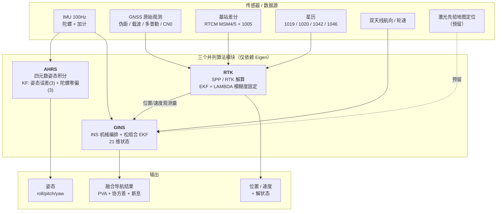

# 导航算法模块重构设计

> 状态：待评审
> 数据源：`C:\Users\wxw\Desktop\松组合原始数据\debug_0x51~0x56`
> 参考实现：`Rtgins`（KF-GINS，武汉大学 i2Nav）

---

## 1. 目标：三个并列的算法模块

从 `Rtgins` 中抽出**三个同级、只依赖 Eigen、都以 Kalman 滤波为核心**的模块：

| 模块 | 职责 | 输入 | 输出 | 核心算法 |
|------|------|------|------|---------|
| **AHRS** | 纯姿态解算 | IMU（陀螺 + 加计） | roll / pitch / yaw | 四元数姿态积分 + KF（姿态误差 + 陀螺零偏） |
| **RTK** | 纯卫星定位 | 原始观测（伪距/载波/多普勒）+ 基站差分 + 星历 | 位置 / 速度 / 模糊度固定状态 | SPP/RTK + EKF + LAMBDA 模糊度固定 |
| **GINS** | 松组合融合 | IMU + GNSS/RTK 结果 + 各类约束 | 位置 / 速度 / 姿态 | EKF 21 维（P/V/失准角/零偏/刻度） |

三者关系：

- **可独立运行**：各自都有完整输入输出，不依赖其他模块
- **可级联**：RTK 的位置/速度 → 作为 GINS 的观测量
- **可交叉校验**：AHRS 的姿态 与 GINS 的姿态互相比对

### 1.1 模块架构图



### 1.2 文本版架构图（不依赖渲染器）

```
┌──────────────────────── 数据源 ────────────────────────┐
│  IMU 100Hz    GNSS原始观测    基站差分   星历   双天线/轮速   │
└────┬──────────────┬─────────────┬────────┬──────────┬────┘
     │              │             │        │          │
     │              └──────┬──────┴────────┘          │
     │                     ↓                           │
     │              ┌─────────────┐                    │
     ├─────────────→│    RTK      │                    │
     │              │  SPP / RTK  │                    │
     │              │  + LAMBDA   │                    │
     │              └──────┬──────┘                    │
     │                     │ 位置/速度                  │
     ↓                     ↓                           ↓
┌─────────┐          ┌──────────────┐          ┌──────────────┐
│  AHRS   │          │    GINS      │←─────────│ 约束: NHC/   │
│ 陀螺积分 │          │  松组合 EKF  │          │ ZUPT/OD/激光 │
│ + KF    │          │   21 维状态  │          └──────────────┘
└────┬────┘          └──────┬───────┘
     │                      │
     ↓                      ↓
  姿态                  PVA + 协方差 + 新息
```

### 1.3 共同约束

- 去掉 rtklib / glog / absl / fileio / build 等离线依赖
- 只依赖 **Eigen**
- 保留并验证全部补偿算法（圆锥 / 划桨 / 旋转效应 / 哥氏 / 重力）
- 状态维度运行期确定，为后续 SLAM 扩维预留
- 三个模块共用一套 `angle / earth / rotation` 基础库

---

## 2. 现状分析

### 2.1 体积构成

| 部分 | 大小 | 处理 |
|------|------|------|
| `rtklib/rtklib.h` | 86.7 KB | **丢弃**（只被离线文件读取和 main 用） |
| `build/` + `ThirdParty/` | 数百 MB | **丢弃** |
| `fileio/`（5 个文件） | 9.4 KB | **丢弃**（实时不从文件读） |
| `common/logging.h` | 2.6 KB | **丢弃**（依赖 glog + absl） |
| `kf_gins.cpp`（main） | 18 KB | **丢弃**，只保留 main 里的参数赋值为配置结构 |
| **核心算法** | **~64 KB** | **全部保留** |

### 2.2 保留清单

| 文件 | 大小 | 职责 |
|------|------|------|
| `common/earth.h` | 8.6 KB | WGS84 地球模型：重力、子午/卯酉圈半径、BLH↔ECEF↔四元数 |
| `common/rotation.h` | 4.3 KB | 反对称矩阵、旋转矢量↔四元数↔DCM↔欧拉角 |
| `common/angle.h` | 1.6 KB | 角度常量（D2R/R2D）、角度归一化 |
| `common/types.h` | 1.7 KB | `IMU` / `GNSS` / `Pose` 结构体 |
| `kf-gins/kf_gins_types.h` | 5.6 KB | `PVA` / `NavState` / `ImuNoise` / `GINSOptions` |
| `kf-gins/insmech.h/.cpp` | 10.2 KB | INS 机械编排（速度/位置/姿态更新） |
| `kf-gins/gi_engine.h/.cpp` | 32 KB | EKF：预测、更新、反馈、ZUPT |

### 2.3 依赖图

```
gi_engine.cpp
  ├─ common/earth.h      → types.h + Eigen
  ├─ common/rotation.h   → Eigen
  ├─ insmech.h           → types.h + kf_gins_types.h
  └─ gi_engine.h         → types.h + kf_gins_types.h + Eigen
                              └─ common/angle.h
```

**结论：核心链路零外部依赖，只有 Eigen。**

---

## 3. 补偿算法现状（已全部实现，无需重写）

### 3.1 圆锥补偿（Coning）——已实现，二阶

位置：[insmech.cpp#L180-L184](file:///c:/Users/wxw/Desktop/QT/TASoftware/forensen_combnitation/Rtgins/src/kf-gins/insmech.cpp#L180-L184)

```cpp
// 补偿二阶圆锥误差（均匀采样假设）
temp1 = imucur.dtheta + imupre.dtheta.cross(imucur.dtheta) / 12;
qbb   = Rotation::rotvec2quaternion(temp1);
```

等效公式：

$$
\Delta\boldsymbol{\theta}_{k} = \boldsymbol{\theta}_{k} + \frac{1}{12}\,\boldsymbol{\theta}_{k-1} \times \boldsymbol{\theta}_{k}
$$

### 3.2 划桨补偿（Sculling）——已实现，二阶

位置：[insmech.cpp#L55-L63](file:///c:/Users/wxw/Desktop/QT/TASoftware/forensen_combnitation/Rtgins/src/kf-gins/insmech.cpp#L55-L63)

```cpp
temp1 = imucur.dtheta.cross(imucur.dvel) / 2;    // 旋转效应
temp2 = imupre.dtheta.cross(imucur.dvel) / 12;   // 划桨项（陀螺前 × 加计后）
temp3 = imupre.dvel.cross(imucur.dtheta) / 12;   // 划桨项（加计前 × 陀螺后）
d_vfb = imucur.dvel + temp1 + temp2 + temp3;
```

$$
\Delta\mathbf{v}_{k}^{b} = \Delta\mathbf{v}_{k} + \frac{1}{2}\boldsymbol{\theta}_{k}\times\Delta\mathbf{v}_{k}
+ \frac{1}{12}\boldsymbol{\theta}_{k-1}\times\Delta\mathbf{v}_{k}
+ \frac{1}{12}\Delta\mathbf{v}_{k-1}\times\boldsymbol{\theta}_{k}
$$

### 3.3 哥氏力 / 重力 / 运输率补偿——已实现

位置：[insmech.cpp#L73-L74](file:///c:/Users/wxw/Desktop/QT/TASoftware/forensen_combnitation/Rtgins/src/kf-gins/insmech.cpp#L73-L74)

```cpp
gl << 0, 0, gravity;
d_vgn = (gl - (2 * wie_n + wen_n).cross(pvapre.vel)) * imucur.dt;
```

$$
\Delta\mathbf{v}_{g}^{n} = \Big[\mathbf{g}^{n} - (2\boldsymbol{\omega}_{ie}^{n} + \boldsymbol{\omega}_{en}^{n}) \times \mathbf{v}^{n}\Big]\,\Delta t
$$

- `g^n`：WGS84 正常重力（纬度级数展开 + 高程修正），见 [earth.h#L50-L62](file:///c:/Users/wxw/Desktop/QT/TASoftware/forensen_combnitation/Rtgins/src/common/earth.h#L50-L62)
- `2ω_ie^n`：哥氏加速度
- `ω_en^n`：载体运动引起的 n 系转动（运输率）

**采用中点法二次迭代**：先用 k-1 时刻参数算一次，外推 k-1/2 位置/速度后再算一次，精度更高。

### 3.4 地球自转补偿——已实现

- 速度更新：[insmech.cpp#L67-L69](file:///c:/Users/wxw/Desktop/QT/TASoftware/forensen_combnitation/Rtgins/src/kf-gins/insmech.cpp#L67-L69) `cnn = I - skew((wie_n + wen_n)*dt/2)`
- 位置更新：[insmech.cpp#L134-L139](file:///c:/Users/wxw/Desktop/QT/TASoftware/forensen_combnitation/Rtgins/src/kf-gins/insmech.cpp#L134-L139) 四元数连乘
- 姿态更新：[insmech.cpp#L177-L178](file:///c:/Users/wxw/Desktop/QT/TASoftware/forensen_combnitation/Rtgins/src/kf-gins/insmech.cpp#L177-L178)

### 3.5 IMU 误差补偿——已实现

位置：[gi_engine.cpp#L211-L222](file:///c:/Users/wxw/Desktop/QT/TASoftware/forensen_combnitation/Rtgins/src/kf-gins/gi_engine.cpp#L211-L222)

```cpp
imu.dtheta -= gyrbias * dt;              // 陀螺零偏
imu.dvel   -= accbias * dt;              // 加计零偏
imu.dtheta  = dtheta ./ (1 + gyrscale); // 陀螺刻度（比例因子）
imu.dvel    = dvel   ./ (1 + accscale); // 加计刻度
```

### 3.6 固化参数（当前代码内的值）

| 参数 | 值 | 位置 |
|------|-----|------|
| ZUPT 陀螺阈值 | 1.0 °/s | [gi_engine.h#L260](file:///c:/Users/wxw/Desktop/QT/TASoftware/forensen_combnitation/Rtgins/src/kf-gins/gi_engine.h#L260) |
| ZUPT 加计阈值 | 0.5 m/s² | 同上 |
| ZUPT 速度阈值 | 0.5 m/s | 同上 |
| ZUPT 速度噪声 | 0.01 m/s | 同上 |
| 速度卡方门限 | 11.34（χ²(3), 99%） | [gi_engine.cpp#L415](file:///c:/Users/wxw/Desktop/QT/TASoftware/forensen_combnitation/Rtgins/src/kf-gins/gi_engine.cpp#L415) |
| 重力模型 | WGS84 正常重力 + 高程修正 | [earth.h#L50](file:///c:/Users/wxw/Desktop/QT/TASoftware/forensen_combnitation/Rtgins/src/common/earth.h#L50) |
| 地球自转 | WGS84_WIE = 7.2921151467e-5 rad/s | angle.h |

### 3.7 算法成立的前提（必须满足）

| 前提 | 实测 | 结论 |
|------|------|------|
| IMU 采样间隔均匀 | **严格 10 ms（100 Hz）** | ✅ |
| 输入为增量形式 | CSV 是角速度/比力，需自己乘 dt | ⚠️ 适配层要转换 |
| 相邻周期角速度线性变化 | 100 Hz 下近似成立 | ✅ |
| 无数据丢失 | 3000 点无异常 | ✅ |

---

## 4. 目录结构（三模块总览）

```
modules/nav/                       # 导航算法总目录
├── common/                        # 三模块共用基础库
│   ├── angle.hpp                  # ← common/angle.h
│   ├── earth.hpp                  # ← common/earth.h
│   ├── rotation.hpp               # ← common/rotation.h
│   └── nav_types.hpp              # 共用的时间/坐标/PVA 结构
│
├── ahrs/                          # 模块 1：纯姿态
│   ├── core/
│   │   ├── ahrs_types.hpp         # 姿态状态/噪声配置
│   │   └── ahrs_engine.hpp/.cpp   # 四元数积分 + KF
│   ├── adapter/
│   └── CMakeLists.txt
│
├── rtk/                           # 模块 2：纯定位
│   ├── core/
│   │   ├── rtk_types.hpp          # 观测值/星历/解结构
│   │   ├── ephemeris.hpp/.cpp     # 卫星位置/钟差
│   │   ├── atmosphere.hpp/.cpp    # 电离层/对流层
│   │   ├── spp_solver.hpp/.cpp    # 单点定位（RTK 降级）
│   │   ├── ambiguity.hpp/.cpp     # LAMBDA 模糊度固定
│   │   └── rtk_engine.hpp/.cpp    # RTK 主引擎
│   ├── adapter/
│   └── CMakeLists.txt
│
└── gins/                          # 模块 3：松组合融合
    ├── core/
    │   ├── gins_types.hpp         # ← types.h + kf_gins_types.h
    │   ├── ins_mech.hpp/.cpp      # ← insmech.h/.cpp
    │   └── gins_engine.hpp/.cpp   # ← gi_engine.h/.cpp
    ├── adapter/
    │   ├── frame_adapter.hpp/.cpp # 0x51/0x52/0x53 → IMU/GNSS
    │   ├── lidar_adapter.hpp/.cpp # 先验地图定位 → LidarObservation（预留）
    │   └── gins_service.hpp/.cpp  # QObject 封装（可选）
    └── CMakeLists.txt
```

### 4.1 对外接口（GINS core 层）

```cpp
class GinsEngine {
public:
    explicit GinsEngine(const GinsConfig &cfg);

    // ---- 数据注入 ----
    void addImu(const ImuSample &imu);                          // 100 Hz，增量
    void addGnssPos(const Vector3d &blh, const Vector3d &std);
    void addGnssVel(const Vector3d &vel, const Vector3d &stdvel);
    void addHeading(double yaw, double stdDeg);                 // 双天线
    void addOdo(double vel, double std);                        // 轮速
    void addLidar(const LidarObservation &obs);                 // 激光（预留）

    // ---- 运动状态标记（外部可强制，内部也会自动判定）----
    void setStationary(bool on);                                // → 触发 ZUPT / ZARU / 零偏观测
    void setMotionMode(MotionMode m);                           // 静止/直线/转弯 → NHC 权重

    // ---- 推进 ----
    void step();                                                // 推进一个 IMU 周期

    // ---- 结果 ----
    NavState state() const;
    Eigen::MatrixXd covariance() const;
    GinsDebug debug() const;
};

// 观测与约束开关：全部预留，按需开启
struct GinsConfig {
    int rank = 21;              // 21=基础；27=扩 SLAM

    // 外部观测
    bool useGnssPos = true;     // 3 维
    bool useGnssVel = true;     // 3 维
    bool useHeading = true;     // 1 维（双天线）
    bool useLidar   = false;    // 3 维（预留）

    // 运动约束
    bool useZupt    = true;     // 3 维，零速
    bool useZaru    = true;     // 3 维，零角速率
    bool useNhc     = true;     // 2 维，非完整
    bool useOd      = false;    // 1 维，轮速（无数据，默认关）

    // 辅助约束
    bool useTilt    = false;    // 2 维，加速度辅助水平姿态
    bool useBiasObs = false;    // 6 维，静止零偏观测

    // 噪声参数（略）
};
```

与 Rtgins 的差异：`newImuProcess()` 简化为 `step()`，因为数据是同步喂入的。

### 4.2 状态量：21 维

| ID | 块 | 含义 | 单位 |
|----|-----|------|------|
| 0 | P | 位置误差 | m |
| 3 | V | 速度误差 | m/s |
| 6 | Φ | 失准角 | rad |
| 9 | Bg | 陀螺零偏 | rad/s |
| 12 | Ba | 加计零偏 | m/s² |
| 15 | Sg | 陀螺刻度因数 | ppm |
| 18 | Sa | 加计刻度因数 | ppm |

### 4.3 状态扩维预留（为后续 SLAM 集成）

**设计原则**：当前 21 维固定，但状态维度做成**构造时确定**，不在代码里写死，扩维只需改初始化，不动核心算法。

```cpp
class GinsEngine {
    // 当前 21，扩维后 27（示例）
    int rank_;                    // 运行期确定，不是 const
    Eigen::MatrixXd Cov_;         // rank_ × rank_
};

enum StateID {
    P_ID = 0, V_ID = 3, PHI_ID = 6, BG_ID = 9, BA_ID = 12, SG_ID = 15, SA_ID = 18,
    // ---- 以下为扩维槽位，当前不启用 ----
    LIDAR_LEVER_ID = 21,          // 激光相对 IMU 杆臂 (3)
    LIDAR_TIME_ID  = 24,          // 激光时间偏移 (1)
    MAP_ORIGIN_ID  = 25,          // 地图原点偏差 x/y (2)
    RANK_BASE      = 21,
    RANK_EXT       = 27
};
```

扩维时需要动的地方只有三处：

| 位置 | 改动 |
|------|------|
| 构造函数 | 传入 `rank_`，`Cov_` / `dx_` 按新维度分配 |
| `insPropagation()` 的 F 矩阵 | 追加 `F.block(LIDAR_LEVER_ID, LIDAR_LEVER_ID, ...)` 等 |
| 激光观测的 H 矩阵 | 在对应扩展列填值（如杆臂对位置的偏导） |

**不扩维时**：扩展状态不分配、F/H 矩阵不加 block，性能与 21 维完全一致。

**为什么现在就要定**：如果写死 `const int RANK = 21` 并把矩阵尺寸硬编码，后面加 SLAM 要将 `gi_engine` 大部分代码重写。改成运行期维度，扩维成本降低一个量级。

### 4.4 观测与约束全集（工程常用，全部预留）

| 类别 | 约束 | 缩写 | 维度 | 输入源 | 触发条件 | 默认 |
|------|------|------|------|--------|---------|------|
| **外部定位** | GNSS 位置 | GPS-P | 3 | 0x52 | 有效解 | 开 |
| | GNSS 速度 | GPS-V | 3 | 0x52 | 有效解 | 开 |
| | 双天线航向 | HEADING | 1 | 0x53 | 固定解 | 开 |
| | 激光先验地图定位 | LIDAR | 3 | 预留 | 匹配成功 | 关 |
| **速度约束** | 零速修正 | ZUPT | 3 | 静止检测 | 三条件同时满足 | 开 |
| | 非完整约束 | NHC | 2 | 运动学 | 行驶且非静止 | 开 |
| | 里程计 | OD | 1 | 0x54 | 有轮速数据 | 关 |
| **角速度约束** | 零角速率修正 | ZARU | 3 | 静止检测 | 静止 | 开 |
| **姿态约束** | 加速度辅助水平姿态 | TILT | 2 | 加计 | 比力模长 ≈ g | 关 |
| **零偏约束** | 静止零偏观测 | ZBO | 6 | 静止检测 | 静止且陀螺/加计稳定 | 关 |
| **待确认** | CUPT | ? | ? | ? | ? | 待定 |

**关于 CUPT**：常见工程约束里没有这个标准缩写。可能是指以下几种之一，需要你确认：

| 猜测 | 含义 | 观测 |
|------|------|------|
| Course Update | 运动方向与航向一致性 | 由速度方向反推航向 |
| Constant Velocity Update | 匀速约束 | 加速度≈0 |
| 拼写变体 | 实际是 ZUPT / ZARU | — |

确认后补进上表即可，配置结构体里预留了位置。

**约束之间的互斥关系**（避免重复约束导致过度收敛）：

| 场景 | 启用 | 禁用 |
|------|------|------|
| 静止 | ZUPT + ZARU + ZBO | NHC + OD（速度为 0 时 NHC 无意义） |
| 直线行驶 | GNSS + NHC + OD | ZUPT / ZARU / ZBO |
| 转弯 | GNSS + OD（NHC 降权） | ZUPT / ZARU |
| GNSS 丢失 | NHC + OD + ZUPT 兜底 | GPS-P / GPS-V |

---

## 5. 数据契约

### 5.1 0x51 IMU（100 Hz，10 ms 严格均匀）

| CSV 列 | → 结构体字段 | 转换 |
|--------|-------------|------|
| 周内毫秒 / GPS周 | `time` | 周内秒 + 周×604800 |
| 陀螺X/Y/Z (deg/s) | `dtheta[0..2]` | `× π/180 × dt` |
| 加表X/Y/Z (g) | `dvel[0..2]` | `× 9.80665 × dt` |
| 温度(C) | 可选：温补输入 | — |
| 状态 | 有效标志 | 判断是否可用 |
| 组合导航横滚/俯仰/航向 | **仅用于初始对准** | 不作为观测 |
| 北/东/地速度、纬度/经度/高度 | **仅用于初始状态** | 不作为观测 |

> 注意：0x51 里虽然带了组合导航结果，但那是设备内部的，**不能反过来当观测量用**（会形成闭环自激）。只取 IMU 原始数据 + 首帧初始状态。

### 5.2 0x52 GNSS 定位（10 Hz）

| CSV 列 | → 字段 | 转换 |
|--------|--------|------|
| 周内毫秒 + GPS周 | `time` | 同上 |
| 定位类型 | 质量门限 | 17=PSRDIFF, 50=RTK固定 |
| **纬度/经度 (deg)** | `blh[0..1]` | `× π/180` |
| 高度 (m) | `blh[2]` | 直接 |
| 北/东/地速度 (m/s) | `vel[0..2]` | 直接 |
| **水平位置精度** | `std[0]=std[1]` | **cm → m（÷100）** |
| 垂直位置精度 | `std[2]` | 同上 |
| 水平速度精度 | `stdvel[0]=stdvel[1]` | 同上 |
| 垂直速度精度 | `stdvel[2]` | 同上 |

> 已确认：精度字段单位为 **cm**。例：水平精度 155 → σ = 1.55 m。

### 5.3 0x53 双天线 RTK（10 Hz）

| CSV 列 | → 字段 |
|--------|--------|
| 航向 (deg) | `heading`（×π/180） |
| 航向标准差 (deg) | `stdheading` |
| 定位类型 | 门限（50=固定解才可用） |

### 5.4 0x54 轮速（当前为空）

只有表头，无数据。**OD 通路需要你补一份有轮速的数据**，否则只能用仿真验证。

字段：前左/前右/后左/后右轮速 (cm/s)、挡位、转向角。

### 5.5 0x56 参数 → GinsOptions

| 参数名 | 实测值 | → GinsOptions |
|--------|--------|--------------|
| GPS_HACC_FIX | 0.15 | 位置观测噪声（固定解） |
| GPS_HACC_SINGLE | 0 | 位置观测噪声（单点） |
| GPS_HEADING_ACC | 1.5 | 航向观测噪声（deg） |
| GYRO_STD | 0.05 | 陀螺零偏稳定性 |
| ACCEL_STD | 0.01 | 加计零偏稳定性 |
| GYRO_ZUPT_VALUE | 1.0 | ZUPT 陀螺阈值 |
| PARAM_INST_ROLL/PITCH/YAW | 0 / -0.002932 / -0.000942 | 安装角 |
| **PARAM_GPS_POS_X/Y/Z** | **0.231 / 0.564 / -0.797** | **杆臂 antlever** |
| PARAM_OD_POS_X/Y/Z | 0.2 / 0.09 / 0.745 | 轮速杆臂 |
| PARAM_ANTENNA_INST_ANGLE | -90.0 | 天线安装角 |
| PARAM_OD_K | 1.0 | 里程计刻度 |
| ODR | 5 | 轮速更新率 |

缺失项（需代码内置默认值）：ARW、VRW、初始协方差、相关时间。

---

## 6. 本期新增功能

### 6.1 位置更新卡方检验

现状：只有速度有卡方（[gi_engine.cpp#L415-L420](file:///c:/Users/wxw/Desktop/QT/TASoftware/forensen_combnitation/Rtgins/src/kf-gins/gi_engine.cpp#L415-L420)），位置裸奔。

改法：在位置 `EKFUpdate` 前加同构检查。

```
γ = dzᵀ · (H·P·Hᵀ + R)⁻¹ · dz
γ < 11.34 → 更新；否则跳过
```

### 6.2 NHC 非完整约束

车体横向、垂向速度为零：

$$
v_y^b = 0,\quad v_z^b = 0
$$

观测方程（2 维）：

$$
\mathbf{z} = \mathbf{C}_n^b\,\mathbf{v}^n \big|_{y,z} = 0,\qquad
\mathbf{H} = [\,0_{2\times3}\ \ \mathbf{C}_{n,2:3}\ \ \text{姿态偏导}\ \ 0\,]
$$

- 噪声：横向 σ = 0.1 m/s，垂向 σ = 0.05 m/s
- 触发条件：速度 > 1 m/s 且非静止（静止交给 ZUPT）

### 6.3 OD 轮速辅助

观测：`v_x^b = odovel × (1 + k_od)`

- 1 维观测，H 对应 `V_ID` 行 × `C_n^b` 第 0 行
- 同时估计刻度系数 `k_od`（需扩展 1 维状态，或沿用 SG/SA 块）
- 数据未到位前：接口先留好，默认关闭

### 6.4 激光雷达观测（先验地图定位，多源融合的第二路定位源）

**核心澄清**：

- **不是**在线 SLAM（边建图边定位）
- **是**基于**先验地图**的定位（Localization on prior map）：地图用扫描仪（三维激光扫描仪）**离线扫好**，运行时实时点云与固定地图做匹配，只输出位姿
- 融合架构：**GNSS + 激光定位 + IMU 三源**

**两种技术形态**：

| 方式 | 原理 | 适用 |
|------|------|------|
| AMCL / 2D 栅格匹配 | 粒子滤波在占据栅格地图上定位 | 2D 激光，室内/平面场景 |
| NDT / ICP / 3D 点云匹配 | 实时点云与 3D 地图配准 | 3D 激光，室外大场景 |

常见组合：AMCL 粗定位给初值 → NDT/ICP 精配准。

#### 6.4.1 坐标系（最关键的一环）

地图的坐标基准决定要不要在线标定：

| 地图基准 | 来源 | 处理 |
|---------|------|------|
| **A. 已配准到 WGS84 / ENU** | 扫描时打了 GPS 控制点或已知坐标标靶 | **直接可用**，无需在线对齐 |
| **B. 局部坐标** | 扫描仪自身坐标系 | 需一次性求 `T_map→enu`（3 维平移 + 1 个 yaw），用控制点或首帧 GNSS 固定解标定后固定 |

> 如果是 A，融合链路最干净：激光定位输出直接就是 ENU/BLH，和 GNSS 在同一坐标系下做双源校验。

#### 6.4.2 数据结构

```cpp
struct LidarObservation {
    double time;

    Vector3d pos;        // 地图坐标（必要时经 T_map→enu 转到 ENU/BLH）
    Vector3d std;        // 位置标准差（3 维）
    double   quality;    // 匹配质量 0~1（内点率/匹配分数），用于 R 自适应

    bool     hasAtt;     // 是否带姿态
    Vector3d att;        // roll/pitch/yaw [rad]（可选）
    Vector3d stdAtt;     // 姿态标准差（可选）
};
```

#### 6.4.3 观测模型（位置，3 维）

与 GNSS 位置更新完全同构：

$$
\mathbf{z} = \mathbf{p}_{lidar} - \mathbf{p}_{ins},\qquad
\mathbf{H} = \big[\ \mathbf{I}_3\ \ \mathbf{0}\ \ \big(\mathbf{C}_b^n\mathbf{l}_{lidar}\big)_\times\ \ \mathbf{0}\ \big]
$$

- 杆臂 `l_lidar` 耦合到失准角，和 GNSS 天线杆臂同理
- 若定位还输出姿态，可追加 2~3 维姿态观测（只取它比 INS 更可信的分量）

#### 6.4.4 与在线 SLAM 的本质差异

| | 在线 SLAM | **先验地图定位（本方案）** |
|---|---|---|
| 建图 | 实时建 | 离线扫描仪建好，固定不变 |
| **累积漂移** | **有**，越走越偏 | **无累积漂移**，每帧直接对固定地图 |
| 初始化 | 需先建图 | 立即可用 |
| 失效模式 | 缓慢漂移 | **匹配失败 → 瞬时跳变** |
| 坐标系 | 局部，必须对齐 | 取决于地图是否已配准 |
| 环境变化 | 自适应 | **怕变化**（长草、堆物、新增车辆） |

**最大优势**：无累积漂移。这是先验地图定位相对 SLAM 的核心价值——不会像 SLAM 那样长时间运行后整体偏移。

**最大风险**：地图与现场不一致 → 匹配失败 → 跳到错误位置。必须靠卡方拦截。

#### 6.4.5 卡方检验（必须有）

$$
\gamma = \mathbf{z}^{T}\big(\mathbf{H}\mathbf{P}\mathbf{H}^{T} + \mathbf{R}\big)^{-1}\mathbf{z} < 11.34
$$

匹配失败时会给出**数米到数十米的瞬时跳变**，没有门限会直接毁掉滤波器。

#### 6.4.6 R 的自适应

用匹配质量做启发式映射：

$$
\sigma_{lidar} = \sigma_{base} \cdot \frac{1}{\max(q,\ 0.1)},\qquad q \in [0,1]
$$

- `q → 1`（匹配好）：σ 接近基准
- `q → 0.1`（退化）：σ 放大 10 倍，自动降权

#### 6.4.7 系统误差要单独考虑

地图配准误差（扫描仪建图时的配准精度）是**系统误差**，不是随机误差。它会**恒定地**带进定位结果，卡方拦不住（因为每帧都偏同样的量）。

处理方式：
- 建图时用高精度控制点（RTK 实测），把配准误差压到厘米级
- 或在 R 里预留一个固定的 floor（如 0.05 m），承认这部分误差存在

#### 6.4.8 三源融合的降级链

| 可用观测量 | 位置约束来源 | 说明 |
|-----------|-------------|------|
| GNSS + 激光 + IMU | 双源信息叠加 | 最优 |
| 激光 + IMU | 地图定位 | 无累积漂移，但怕环境变化 |
| GNSS + IMU | 卫星定位 | 常规 |
| 仅 IMU | NHC + OD + ZUPT 维持 | 短时可用，长时发散 |

#### 6.4.9 当前状态

- 0x0200 激光标定帧已证实硬件侧有激光测距链路（`dist_now`/`base_pos`/`laser_install_att`）
- 先验地图定位输出**尚无数据**
- 本期只定接口、观测模型、坐标对齐方案，不实现数据适配

**接入前置条件**：
1. **地图的坐标基准**：已配准到 WGS84/ENU，还是局部坐标？
2. 定位输出频率、延迟量
3. 是否有匹配质量指标（内点率/残差/匹配分数）
4. 是否输出姿态，roll/pitch/yaw 各自精度
5. 扫描仪建图的配准精度（控制点实测精度）

---

## 7. 风险与待确认

| # | 项 | 说明 |
|---|-----|------|
| 1 | **位置精度单位** | 0x52 水平精度 155，疑为 cm（1.55 m）。需用固定解帧交叉验证 |
| 2 | **定位类型码表** | 17 / 50 的语义需与固件确认（推测 DGPS / RTK Fixed） |
| 3 | **航向基准** | 0x53 航向是天线基线方向还是车头方向？`PARAM_ANTENNA_INST_ANGLE=-90°` 说明有安装偏差 |
| 4 | **安装角符号** | 0x56 的 INST_PITCH/YAW 单位是 rad 还是 deg？实测 -0.0029 像 rad |
| 5 | **刻度因数可观性** | 保留 21 维后，SG/SA 在 GNSS 良好时基本不可观，建议初值协方差给小、过程噪声趋零 |
| 6 | **OD 数据** | 0x54 全空，无法验证轮速通路 |
| 7 | **checkCov 行为** | 原版 `std::exit()` 会直接杀进程，新模块必须改为降级/复位策略 |
| 8 | **0x51 里的组合导航结果** | 确认不参与滤波（避免闭环自激） |
| 9 | **先验地图接入细节未确认** | 方案已定：扫描仪离线建图 + 实时匹配。待确认：地图坐标基准（WGS84 还是局部）、定位延迟、匹配质量指标、建图配准精度 |

---

## 8. 实施步骤

| 阶段 | 内容 | 验收 |
|------|------|------|
| 1 | 抽 core：angle/earth/rotation/types/insmech | 编译通过，无 rtklib/glog 引用 |
| 2 | 移植 gi_engine → gins_engine，去掉 exit/日志，状态维度运行期化 | 编译通过 |
| 3 | 写 frame_adapter：0x51/0x52/0x53 → IMU/GNSS | 读三份 CSV 跑通全程 |
| 4 | **输出结果**：PVA + 协方差 + 调试量 | 生成结果 CSV，供外部与组合导航对比 |
| 5 | 位置更新卡方 | 注入野值能看到被拦截 |
| 6 | ZUPT + ZARU（现有 ZUPT 扩展为配置项） | 静止时速度/角速度收敛到 0 |
| 7 | NHC 非完整约束（可配置开关） | 模拟 GNSS 中断，位置漂移明显减小 |
| 8 | OD 接口（待数据，默认关闭） | 接口就绪 |
| 9 | TILT / ZBO 可选约束 | 开关打开后可运行 |
| 10 | SLAM 观测接口 + 状态扩维槽位 | 接口与枚举就绪，不实现计算 |
| 11 | Qt 适配层接入 TASoftware | 实时跑通 |

**交付边界**：模块只负责「输入 IMU + GNSS + 双天线 + 轮速 + 各类约束 → 输出导航结果」。与设备组合导航结果的对拍由使用方完成，模块本身不包含对拍工具。

**阶段 4 的输出**：按 0x51/0x55 的格式导出同样的字段（姿态、位置、速度、协方差、新息），外部直接按时间戳逐行对比即可。

---

## 9. 待你确认的问题

### 已确认

| # | 问题 | 结论 |
|---|------|------|
| 1 | 位置/速度精度单位 | **cm**（155 → 1.55 m） |
| 2 | 0x53 航向基准 | **天线基线方向，需大角度补偿**（对应 `PARAM_ANTENNA_INST_ANGLE=-90°`），符号待实车验证 |
| 3 | 模块目录名 | **`modules/gins/`** |
| 5 | 激光雷达形态 | **扫描仪离线建图的先验地图定位**，GNSS + 激光 + IMU 三源 |

### 待确认

| # | 项 | 说明 |
|---|-----|------|
| 1 | **CUPT 具体含义** | 工程常见约束里没有这个标准缩写。可能是 Course Update / Constant Velocity Update / ZUPT 的笔误。确认后补进 4.4 的约束表，配置结构体已留位置 |
| 2 | **地图坐标基准** | 已配准到 WGS84/ENU（A），还是扫描仪局部坐标（B）？影响是否需要 `T_map→enu` 标定 |
| 3 | **轮速数据** | 0x54 全空，OD 通路无法验证 |
| 4 | **定位类型码表** | 0x52 的 17 / 0x53 的 50 的准确语义（推测 PSRDIFF / RTK Fixed） |

### 关于验证方式（已按你的要求调整）

- 模块输出：姿态、位置、速度、协方差、新息，字段对齐 0x51/0x55
- **对拍由你那边完成**，模块不含对拍工具
- 对比项：与设备"组合导航横滚/俯仰/航向"及位置速度逐时刻比较

---

## 10. RTK 模块设计（纯定位）

### 10.1 职责边界

| 项 | 内容 |
|----|------|
| **输入** | 原始观测（伪距/载波/多普勒/CN0）、基站差分（RTCM MSM4/5 + 1005/1006）、星历（1019/1020/1042/1044/1046） |
| **输出** | 位置（BLH）、速度（NED）、解状态（SPP/DGPS/RTK-Float/RTK-Fixed）、协方差、模糊度固定状态 |
| **不负责** | IMU 融合（GINS）、姿态解算（AHRS） |

### 10.2 内部结构

```
rtk_engine              主引擎：调度 → 单点 → 双差 → 模糊度固定
  ├── ephemeris         卫星位置/速度/钟差（开普勒轨道外推 + 钟差多项式）
  ├── atmosphere        电离层（Klobuchar）、对流层（Saastamoinen / UNB3）
  ├── spp_solver        单点定位（最小二乘 / EKF），给 RTK 提供初值
  ├── ambiguity         LAMBDA 整数最小二乘搜索 + 比率检验
  └── rtk_filter        双差 EKF（状态：位置3 + 速度3 + 双差模糊度N）
```

### 10.3 KF 状态

$$
\mathbf{x} = \big[\ \mathbf{p}_{ecef}(3)\ \ \mathbf{v}_{ecef}(3)\ \ N_1 \dots N_m\ \big]^T
$$

- 位置/速度：常速模型或随机游走
- 模糊度：固定前按浮点估计，固定后转为整数约束
- 每颗卫星每个频点一个模糊度，**m 随卫星数变化 → 维度必须运行期可变**

### 10.4 关键算法

| 环节 | 算法 | 说明 |
|------|------|------|
| 单点定位 | 加权最小二乘 / EKF | 给 RTK 提供初值与钟差 |
| 双差观测 | 站间 + 星间差分 | 消钟差、电离层、对流层、星历误差 |
| 模糊度浮点解 | EKF | 双差残差最小化 |
| 模糊度固定 | **LAMBDA** | 整数最小二乘搜索 + 比率检验（ratio > 3 判定固定） |
| 质量控制 | 卡方 + 残差检验 | 剔除粗差卫星 |

### 10.5 降级链

```
RTK-Fixed（固定解，cm 级）
   ↓ 固定失败
RTK-Float（浮点解，dm 级）
   ↓ 基站数据中断
DGPS / SPP（单点，m 级）
```

### 10.6 实现路径（已确认：源码级重写为 C++）

**结论**：不做「C 库 + C++ wrapper」两层，**直接拿 RTKLIB 源码改写成 C++ 类**。

理由：

- 两层封装调试时要跨层跳，代码也不干净
- RTKLIB 的**算法逻辑是对的**，但代码风格老旧（全局变量、自研矩阵、trace 日志）
- 重写成 C++ 后只依赖 Eigen，与 GINS/AHRS 风格统一

**改写规则**：

| 原 RTKLIB | 改写后 |
|-----------|--------|
| 全局变量 `prcopt_t opt`、`sol_t sol` | 收进 `RtkEngine` 成员 |
| 自研 `mat` / `matmul` / `matinv` | 换成 Eigen |
| `obsd_t` / `nav_t` / `eph_t` | 改成 struct（保留字段，补构造与默认值） |
| `trace(level, ...)` 日志 | 改成可选回调，默认静默 |
| `rtksvr` / `stream` 文件流 | **整块丢弃**（数据由外部喂入） |
| `rtk_t` 状态结构 | 改成 `RtkFilter` 类的成员 |

**分层与工作量**：

| 层 | 对应 RTKLIB | 处理 | 规模 |
|----|------------|------|------|
| 基础 | `rtkcmn.c` | 时间/坐标/矩阵 → Eigen + 自写时间转换 | ~800 行 |
| 星历 | `ephemeris.c` | 算法原样移植，结构体重构 | ~600 行 |
| 大气 | `ionex.c` `tropmodel.c` | 只留 Klobuchar + Saastamoinen，其余丢 | ~400 行 |
| SPP | `pntpos.c` | 原样移植 + Eigen 化 | ~700 行 |
| 双差 | `rtkpos.c` 的 `udstate`/`ddres` | 重点重构，拆成 filter + observation | ~1200 行 |
| 模糊度 | `lambda.c` | **逐行对照移植，不做任何"优化"** | ~400 行 |
| 主引擎 | `rtkpos.c` 的 `rtkpos` | 重写调度逻辑 | ~500 行 |

合计约 **4500~5000 行**（原 RTKLIB 相关代码约 10000 行，砍掉的一半是 IO 与冗余分支）。

**风险控制**：

1. **LAMBDA（`lambda.c`）必须逐行对照** —— 最容易写错，也最难调试
2. **时间系统单独抽出** —— GPST/UTC/BDT 转换、闰秒，全部单测覆盖
3. **大气模型必须一致** —— 双差方程里的电离层/对流层改正若与 RTKLIB 不同，固定率会异常低

**验证方式**：

- 同一份原始观测 + 基站数据，先用 RTKLIB 官方程序跑出基准结果
- 新模块与基准比对：**固定解位置差 < 1 cm，浮点解 < 10 cm**

---

## 11. AHRS 模块设计（纯姿态，独立模块）

### 11.1 职责边界

| 项 | 内容 |
|----|------|
| **输入** | IMU（陀螺 + 加计） |
| **输出** | roll / pitch / yaw、陀螺零偏、姿态协方差 |
| **航向基准** | **启动时 yaw = 0**，之后纯陀螺积分，输出的是**相对航向** |
| **不负责** | 位置、速度、绝对航向 |

> 不依赖磁力计，也不依赖双天线。上电清零点即航向零点。

### 11.2 KF 状态（6 维）

$$
\mathbf{x} = \big[\ \delta\boldsymbol{\theta}(3)\ \ \mathbf{b}_g(3)\ \big]^T
$$

- 姿态误差 3 维
- 陀螺零偏 3 维（可观性来自 ZARU 和加计水平约束）

### 11.3 观测

| 观测 | 维度 | 来源 | 触发条件 |
|------|------|------|---------|
| 水平姿态 | 2 | 加计 | 比力模长 ≈ g（无大加速度） |
| 零角速率 | 3 | 静止检测 | ZARU |
| ~~航向~~ | — | **无外部航向观测** | — |

**没有航向观测的直接后果**：yaw 的误差完全由陀螺 Z 轴零偏决定，无法被观测修正。

$$
\Delta\psi(t) = b_{gz} \cdot t
$$

| 陀螺 Z 零偏 | 1 分钟 | 10 分钟 | 1 小时 |
|------------|--------|---------|--------|
| 1 °/h | 0.017° | 0.17° | 1° |
| 10 °/h | 0.17° | 1.7° | 10° |
| 100 °/h | 1.7° | 17° | 100° |

**所以 AHRS 的 yaw 只能短时使用**，长时间必须靠外部源（双天线航向 / GNSS 航迹 / 激光定位）重置。这一点要在接口上留出 `resetYaw(double yaw)` 的口子。

### 11.4 与 GINS 的关系

- **完全独立**，不共享状态
- 用途：单独的姿态输出通道（不依赖 GNSS）
- 可作为 GINS 姿态的交叉校验源

### 11.5 核心算法复用

Rtgins 没有独立 AHRS，但 GINS 的 `insMech::attUpdate()` 就是姿态积分核心：

$$
\mathbf{q}_b^n(k) = \mathbf{q}_n^n(k)\ \mathbf{q}_b^n(k-1)\ \mathbf{q}_b^b(k)
$$

其中 $\mathbf{q}_b^b(k)$ 已含二阶圆锥补偿：

$$
\boldsymbol{\theta}_k + \frac{1}{12}\boldsymbol{\theta}_{k-1}\times\boldsymbol{\theta}_k
$$

AHRS 模块直接复用这套四元数更新，只把观测模型换成「加计水平 + 航向」。

---

## 12. 三模块实施顺序

| 阶段 | 模块 | 理由 |
|------|------|------|
| 1 | **common**（angle/earth/rotation/types） | 三模块共用，先抽 |
| 2 | **GINS** | 代码最完整，改动最小，先跑通验证框架 |
| 3 | **AHRS** | 复用 GINS 的姿态积分，工作量小 |
| 4 | **RTK** | 依赖 RTKLIB，最复杂，放最后 |

---

## 13. 待确认（三模块）

| # | 项 | 说明 |
|---|-----|------|
| 1 | ~~RTK 实现路径~~ | **已确认：源码级重写为 C++，不做 C wrapper** |
| 2 | ~~AHRS 航向源~~ | **已确认：启动 yaw = 0，纯陀螺积分，无外部航向观测** |
| 3 | ~~AHRS 是否独立~~ | **已确认：独立模块** |

### 全部决策已闭环，可以开工

实施顺序：`common` → `GINS` → `AHRS` → `RTK`

---

## 14. 实施结果（V1.0 已完成）

三个模块均已完成移植/重写，并通过独立自检。

### 14.1 代码落点

| 模块 | 文件 | 规模 |
|------|------|------|
| common | `modules/nav/common/{angle,nav_types,rotation,earth}.hpp` | 4 个头文件 |
| GINS | `modules/nav/gins/core/{gins_types,ins_mech,gins_engine}` | 5 个文件，约 1100 行 |
| AHRS | `modules/nav/ahrs/core/{ahrs_types,ahrs_engine}` | 3 个文件，约 500 行 |
| RTK | `modules/nav/rtk/core/{rtk_types,rtk_util,atmosphere,ephemeris,ambiguity,spp_solver,rtk_engine}` | 13 个文件，约 2400 行 |
| 依赖 | `modules/nav/third_party/eigen-3.3.9` | 仅 Eigen，无 rtklib/glog/absl |

原 `Rtgins` 参考工程已删除，Eigen 已迁入 `modules/nav/third_party/`。

### 14.2 相对 KF-GINS / RTKLIB 的实质改动

| 模块 | 原实现 | 现实现 | 原因 |
|------|--------|--------|------|
| GINS | `const int RANK = 21` | `rank_` 运行期确定 | 为 SLAM 扩维（21→27）预留 |
| GINS | `checkCov()` 中 `std::exit()` | 钳位 + `healthy()` 标志 | 原版协方差异常会直接杀进程 |
| GINS | 位置更新无卡方 | χ²(3) 门限 11.34 | 位置野值原本直接进滤波器 |
| GINS | 1 Hz 判定 `fmod(time,1) < dt/2` | 整秒计数 | **浮点累积时间戳会整秒跳过，导致 ZUPT/ZARU 永不触发** |
| GINS/AHRS | ZARU 观测矩阵 `H = −I` | `H = +I` | `ω_comp = b_true − b̂`，与误差状态同号；原符号导致零偏估计发散 |
| RTK | 单差模糊度直接进 LAMBDA | 基准星模糊度归零、其余取相对值 | 单差存在不可观测共同偏移，Qbb 奇异 |
| RTK | `ecef2pos` 用 `z += N·e²·sinφ` | `z = r[2] + N·e²·sinφ` | 累加形式不收敛，纬度会偏 1.5° |

### 14.3 自检结果

| 模块 | 检查项 | 结果 |
|------|--------|------|
| GINS | NHC 雅可比（数值 vs 解析） | 4.0e−9 / 5.4e−9 |
| GINS | 静止 20 s 位置漂移 | 1.5e−14 rad |
| GINS | GNSS 拉回（300 历元） | 误差 < 0.001 m |
| GINS | 零偏估计 | 0.3009 / −0.2000 / 0.4978 °/s（真值 0.3 / −0.2 / 0.5） |
| GINS | 100 m 野值卡方拦截 | χ² = 960908，被拒 |
| AHRS | 加计水平对准 | 5.000° / −3.000° |
| AHRS | 纯陀螺航向积分 | 30°/s × 2 s → 60.0000° |
| AHRS | 零偏估计 | 0.3000 / −0.2000 / 0.5000 °/s |
| RTK | 时间 / 坐标往返 | 1e−11 rad 级 |
| RTK | LAMBDA vs 穷举 | 完全一致（3 维） |
| RTK | 单点定位 | 误差 < 1e−4 m |
| RTK | 双差固定 | 5/5 历元 FIXED，位置误差 < 1e−4 m |

### 14.4 使用方式

```cpp
// GINS
nav::gins::GinsConfig cfg;
cfg.initstate.pos   = ...;            // [rad, rad, m]
cfg.initstate.euler = ...;            // [rad]
cfg.antlever        = ...;            // GNSS 杆臂 [m]
nav::gins::GinsEngine gins(cfg);
gins.addImu(imuSample);               // 100 Hz 增量
gins.addGnss(gnssObs);                // 10 Hz（位置/速度/航向可分别有效）
gins.step();
auto s = gins.state();

// AHRS
nav::ahrs::AhrsConfig acfg;
nav::ahrs::AhrsEngine ahrs(acfg);     // 启动 yaw = 0
ahrs.addImu(imuSample);
ahrs.step();
double yaw = ahrs.yaw();

// RTK
nav::rtk::RtkConfig rcfg;
nav::rtk::RtkEngine rtk(rcfg);
rtk.setBasePosition(baseEcef);
nav::rtk::Sol sol = rtk.processEpoch(roverObs, baseObs, nav);
if (sol.stat == nav::rtk::SOLQ_FIX) { /* 固定解 */ }
```

### 14.5 尚未完成

| 项 | 说明 |
|----|------|
| CMakeLists | 三个模块尚未接入 TASoftware 构建系统 |
| Qt 适配层 | 0x51/0x52/0x53 → IMU/GNSS 的转换代码待写 |
| 实数据验证 | 目前只用合成数据自检；需用 0x51/0x52/0x53 真实 CSV 跑通 |
| 北斗 / GLONASS | RTK 目前按 GPS/GAL/QZS 处理，北斗 GEO 有分支但未实测 |
| 长基线 | 未实现电离层/对流层参数估计（IONOOPT_EST / TROPOPT_EST） |
